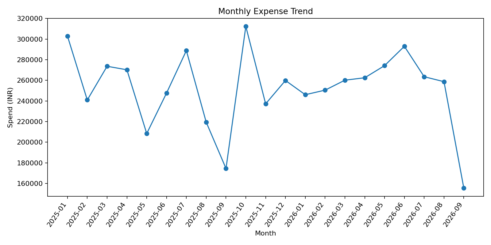
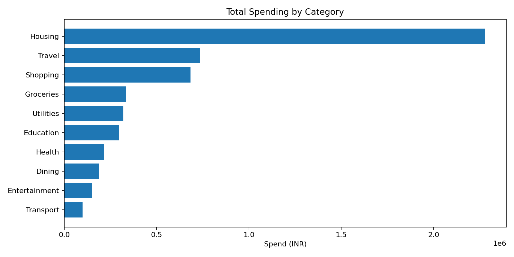

# Expense Tracker Analytics

A data analytics portfolio project that analyzes personal expense transactions using Python, SQL, ETL, exploratory data analysis (EDA), and data visualization. The project transforms raw transaction data into meaningful insights to understand spending patterns, category-wise expenses, monthly trends, and payment behavior.

## Project Overview

Managing expenses becomes easier when transaction data is organized, cleaned, and analyzed. This project demonstrates an end-to-end data analytics workflow, starting with raw CSV data and ending with cleaned datasets, analytical reports, visualizations, and SQL queries.

The dataset contains synthetic transaction records created for learning and portfolio demonstration. It does not contain real personal financial information.

## Project Objectives

- Clean and transform raw transaction data using Python.
- Perform exploratory data analysis to identify spending patterns.
- Analyze monthly and category-wise expenses.
- Store and query transaction data using MySQL.
- Generate summary reports and data visualizations.
- Prepare an interactive dashboard using Power BI.
- Demonstrate an end-to-end data analytics workflow.

## Technology Stack

| Technology | Purpose |
|---|---|
| Python | Data cleaning, transformation, and analysis |
| Pandas | Data manipulation and aggregation |
| NumPy | Numerical operations |
| Matplotlib | Data visualization |
| Seaborn | Statistical visualization |
| MySQL | Data storage and SQL analysis |
| Jupyter Notebook | Exploratory data analysis |
| Power BI | Interactive dashboard development |
| Git and GitHub | Version control and project hosting |

## Project Structure

```text
expense-tracker-analytics/
│
├── data/
│   ├── raw/
│   │   └── transactions_raw.csv
│   └── processed/
│       └── transactions_clean.csv
│
├── notebooks/
│   └── 01_expense_analytics_eda.ipynb
│
├── sql/
│   ├── schema.sql
│   └── analysis_queries.sql
│
├── scripts/
│   ├── clean_data.py
│   └── analyze_data.py
│
├── dashboards/
│   └── POWER_BI_GUIDE.md
│
├── images/
│   ├── monthly_expense_trend.png
│   └── category_spending.png
│
├── reports/
│   ├── monthly_spend.csv
│   ├── category_summary.csv
│   ├── top_10_transactions.csv
│   └── executive_summary.md
│
├── models/
│   └── README.md
│
├── requirements.txt
├── .gitignore
└── README.md
```

## Dataset Overview

The project uses a synthetic transaction dataset with the following characteristics:

- **Total transactions:** 1,800
- **Date range:** January 2025 to September 2026
- **Currency:** Indian Rupees (INR)
- **Input format:** CSV
- **Processed format:** CSV
- **Data preparation:** Missing descriptions and inconsistent category labels are handled by the data-cleaning pipeline.

### Key Dataset Columns

| Column | Description |
|---|---|
| transaction_id | Unique transaction identifier |
| transaction_date | Date of the transaction |
| category | Expense category |
| merchant | Merchant or vendor name |
| description | Transaction description |
| payment_method | Method used for payment |
| amount_inr | Transaction amount in INR |
| account_type | Type of account used |

The processed dataset also contains derived date fields, including month, year, month number, day name, and weekend indicator.

## Data Analytics Workflow

1. **Data Collection:** Load raw transaction records from CSV.
2. **Data Cleaning:** Handle missing values, standardize category labels, and prepare consistent data types.
3. **Data Transformation:** Create useful date-based fields for analysis.
4. **Exploratory Data Analysis:** Investigate transaction amounts, spending categories, and monthly trends.
5. **SQL Analysis:** Use MySQL to store, filter, aggregate, and summarize transactions.
6. **Visualization:** Generate charts to understand expense patterns.
7. **Reporting:** Export summary reports and an executive summary.
8. **Dashboard Development:** Follow the included Power BI guide to create interactive visualizations.

## Key Analysis Areas

### 1. Monthly Spending Analysis
Analyze expenses over time to identify changes in spending and compare monthly totals.

### 2. Category-Wise Spending
Compare spending across categories to understand which areas account for the largest expenses.

### 3. Payment Method Analysis
Examine transaction distribution across payment methods.

### 4. Transaction Analysis
Identify high-value transactions and examine transaction amounts and frequency.

### 5. Data Quality
Prepare raw transaction records for reliable analysis by standardizing values and handling missing descriptions.

## Visualizations

### Monthly Expense Trend



This chart helps visualize how total transaction spending changes over time.

### Category-Wise Spending



This chart compares spending across expense categories.

## Getting Started

### Prerequisites

Install the following software:

- Python 3.10 or a compatible version
- Git
- MySQL Server and MySQL Workbench for SQL analysis
- Jupyter Notebook for notebook-based analysis
- Power BI Desktop for dashboard development

### Step 1: Clone the Repository

Open your terminal or VS Code terminal and run:

```bash
git clone https://github.com/rajwalave/expense-tracker-analytics.git
cd expense-tracker-analytics
```

### Step 2: Create a Virtual Environment

```bash
python -m venv venv
```

Activate it on Windows:

```bash
venv\Scripts\activate
```

### Step 3: Install Dependencies

```bash
pip install -r requirements.txt
```

### Step 4: Clean the Dataset

Run the data-cleaning script:

```bash
python scripts/clean_data.py
```

This prepares the processed transaction dataset.

### Step 5: Generate Analytical Reports

Run:

```bash
python scripts/analyze_data.py
```

The script generates analytical outputs in the `reports/` directory and visualizations in the `images/` directory, according to the project implementation.

### Step 6: Explore the Notebook

Launch Jupyter Notebook:

```bash
jupyter notebook
```

Open:

```text
notebooks/01_expense_analytics_eda.ipynb
```

Run the notebook cells to explore the data and understand the analysis.

## MySQL Database Setup

### Step 1: Create the Database

Open MySQL Workbench and execute:

```sql
CREATE DATABASE expense_tracker;

USE expense_tracker;
```

### Step 2: Create the Table

Execute the SQL statements in:

```text
sql/schema.sql
```

### Step 3: Import the Processed CSV

1. Open MySQL Workbench and connect to your MySQL server.
2. Select the `expense_tracker` database.
3. Right-click the `transactions` table and select **Table Data Import Wizard**.
4. Select `data/processed/transactions_clean.csv`.
5. Map these eight CSV columns to the corresponding table columns:

   - `transaction_id`
   - `transaction_date`
   - `category`
   - `merchant`
   - `description`
   - `payment_method`
   - `amount_inr`
   - `account_type`

6. Skip the derived columns `month`, `year`, `month_number`, `day_name`, and `is_weekend`, because they are not included in the current table schema.
7. Complete the import and run the queries in `sql/analysis_queries.sql`.

## SQL Analysis

The SQL analysis file contains queries for common expense analytics tasks, such as:

- Total spending.
- Total number of transactions.
- Average transaction amount.
- Category-wise spending.
- Monthly spending trends.
- Payment method distribution.
- Highest-value transactions.

Example query for category-wise spending:

```sql
SELECT
    category,
    SUM(amount_inr) AS total_spending,
    COUNT(*) AS transaction_count,
    AVG(amount_inr) AS average_transaction
FROM transactions
GROUP BY category
ORDER BY total_spending DESC;
```

Example query for monthly spending:

```sql
SELECT
    YEAR(transaction_date) AS year,
    MONTH(transaction_date) AS month,
    SUM(amount_inr) AS total_spending
FROM transactions
GROUP BY
    YEAR(transaction_date),
    MONTH(transaction_date)
ORDER BY year, month;
```

## Power BI Dashboard

The project includes a dashboard implementation guide at `dashboards/POWER_BI_GUIDE.md`.

The planned dashboard includes:

- KPI cards for total spending, transaction count, and average transaction amount.
- Monthly spending trend analysis.
- Category-wise spending comparison.
- Payment method distribution.
- Interactive filters for date, category, payment method, and account type.

**Dashboard status:** Instructions are included in the repository. The report must be built in Power BI Desktop; a completed `.pbix` file is not included.

## Project Deliverables

- Raw and processed transaction datasets.
- Python data-cleaning and analysis scripts.
- Jupyter Notebook for exploratory data analysis.
- MySQL database schema and analytical queries.
- Expense analysis charts.
- CSV summary reports.
- Executive summary.
- Power BI dashboard implementation guide.

## Skills Demonstrated

- Python programming
- Data cleaning and preprocessing
- Pandas data manipulation
- Exploratory data analysis
- SQL queries and aggregations
- MySQL database management
- Data visualization
- CSV data processing
- Reporting and documentation
- Git and GitHub version control
- Analytical problem-solving

## Future Improvements

- Build and publish the completed Power BI dashboard.
- Add automated data validation and testing.
- Schedule regular data refreshes.
- Add budget-versus-actual expense analysis.
- Develop monthly spending alerts.
- Add forecasting to estimate future expenses.
- Automate report generation.
